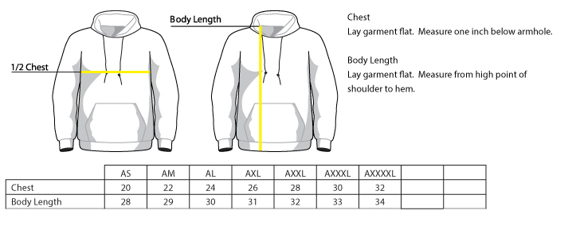
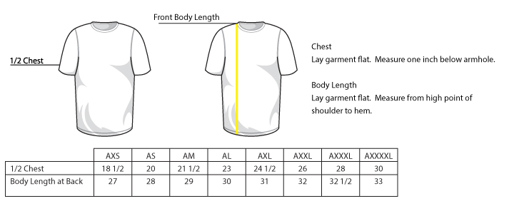
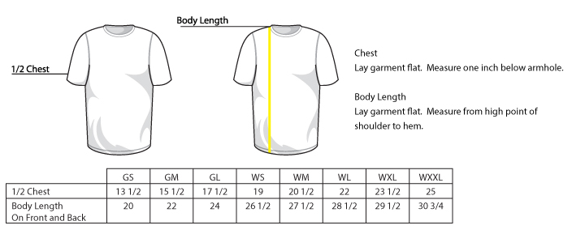
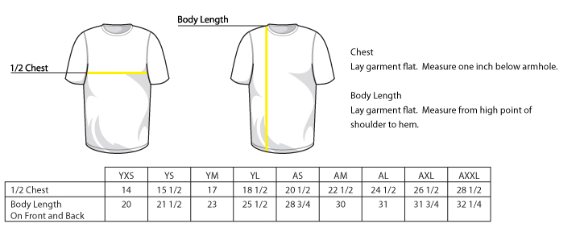

# NCLL uniform specs: models and sizes

The master reference for NCLL uniforms: which hat, shirt and hoodie model each division gets, the supplier size charts (normalized to pit-to-pit), and the sizes offered to players and coaches. The live uniform pages (`CMS/Resources/uniforms-hub.html`, `CMS/uniform-2027.html`) are built from it, so update this first when a model or size range changes. Supplier sheets are next to it in this folder. Moved here from `Resources/Parents/sizing/` 2026-10-29.

> **Intermediate (50/70, new for 2027):** assumed to wear the same as Juniors (PTS30 hat, 4003 shirt, PC90H hoodie; coaches likewise). John approved the assumption 2026-10-30; confirm with the uniform order before it goes out.

## PLAYERS HATS & SHIRTS MODEL CHART

| Program/Division   | Hat Model # | Shirt Model #            | Hoodie Model # | Socks | Belt |
|--------------------|-------------|--------------------------|----------------|-------|------|
| Baseball - T-Ball  | 4301        | ST350                    | none           | none  | none |
| Baseball - Kindy   | 4301        | ST350                    | none           | none  | none |
| Baseball - A       | 4301        | 4003                     | none           | 7101 S | 4350 Youth |
| Baseball - AA      | 4301        | 4003                     | none           | 7101 S | 4350 Youth |
| Baseball - AAA     | PTS30       | 4003                     | PC90HY/PC90H   | 7101 M | 4350 Youth |
| Baseball - Majors  | PTS30       | 4003                     | PC90HY/PC90H   | 7101 M | 4350 Youth |
| Baseball - Intermediate | PTS30       | 4003                     | PC90H          | 7101 M | 4350 Adult |
| Baseball - Juniors | PTS30       | 4003                     | PC90H          | 7101 M | 4350 Adult |
| Baseball - Seniors | PTS30       | 4003                     | PC90H          | 7101 M | 4350 Adult |
| Softball - A       | 4302        | 4408 GIRLS / 4408 WOMENS | none           | 7101 S | 4350 Youth |
| Softball - AA      | 4302        | 4408 GIRLS / 4408 WOMENS | none           | 7101 S | 4350 Youth |
| Softball - AAA     | 4302        | 4408 GIRLS / 4408 WOMENS | PC90HY/PC90H   | 7101 M | 4350 Youth |
| Softball - Majors  | 4302        | 4408 GIRLS / 4408 WOMENS | PC90HY/PC90H   | 7101 M | 4350 Youth |
| Softball - Juniors | 4302        | 4408 WOMENS              | PC90H          | 7101 M | 4350 Adult |
| Softball - Seniors | 4302        | 4408 WOMENS              | PC90H          | 7101 M | 4350 Adult |

## COACHES HATS & SHIRTS MODEL CHART

| Program/Division         | Hat Model #      | Shirt Model # | Hoodie Model # | Socks | Belt |
| -------------------------- | ---------------- | ------------- | -------------- | ----- | ---- |
| Baseball - T-Ball Coaches  | 4301             | ST350         | none           | none  | none |
| Baseball - Kindy Coaches   | 4301             | ST350         | none           | none  | none |
| Baseball - A Coaches       | 4301             | ST350         | none           | none  | none |
| Baseball - AA Coaches      | 4301             | ST350         | none           | none  | none |
| Baseball - AAA Coaches     | PTS30            | ST350/ST550   | PC90H          | none  | none |
| Baseball - Majors Coaches  | PTS30            | ST350/ST550   | PC90H          | none  | none |
| Baseball - Intermediate Coaches | PTS30            | ST350/ST550   | PC90H          | none  | none |
| Baseball - Juniors Coaches | PTS30            | ST350/ST550   | PC90H          | none  | none |
| Baseball - Seniors Coaches | PTS30            | ST350/ST550   | PC90H          | none  | none |
| Softball - A Coaches       | Champro HC10     | 4408 WOMENS   | none           | none  | none |
| Softball - AA Coaches      | Champro HC10     | 4408 WOMENS   | none           | none  | none |
| Softball - AAA Coaches     | Champro HC10     | ST350/ST550   | PC90H          | none  | none |
| Softball - Majors Coaches  | Champro HC10     | ST350/ST550   | PC90H          | none  | none |
| Softball - Juniors Coaches | Champro HC10     | ST350/ST550   | PC90H          | none  | none |
| Softball - Seniors Coaches | Champro HC10     | ST350/ST550   | PC90H          | none  | none |

### Socks and belts (no size question; one size per division)

Decided 2026-11-11 from the 2025 and 2026 Protime invoices (no size question for families; Uniforms orders one size per division). The model chart above uses these.

- **Socks: Protime 7101 All Sport Sock**, sized by shoe size: S = men's/boys 12-4, women's up to 6; M = men's/boys 4 1/2-8 1/2, women's 6 1/2-10 1/2; L = men's/boys 9-12, women's 11-14.
- **Belts: Protime 4350 Baseball Belt**, Youth or Adult.
- A and AA (both sports): socks **S**, belts **Youth**. Both years' A/AA invoices were all Small / all Youth.
- AAA and Majors (both sports): socks **M**, belts **Youth**. Most of the main spring order was Medium socks and Youth belts.
- Intermediate, Juniors and Seniors: socks **M**, belts **Adult**. The 2026 Juniors order was Medium socks (plus 6 Large) and mostly Adult belts.
- 2025 and 2026 also bought some **7102 Pro Sock** (Medium) in the main order; 2027 standardizes on the 7101.
- Team colors vary; the picker shows one color as an example.

### Hoodie: 8203

Decided 2026-11-11: the hoodie is the **8203** (Port & Co PC850H), as in the 2027 sheet. The 2025 main order was 8203 (181); 2026's was the PC90H (Protime 8202, 311), treated as a one-year exception. The PC90H/PC90HY in the charts above are left over from 2026.

## SIZE & LENGTH CARDS

## Legend — measurement conventions

- Pit-to-pit (PTP): the flat measurement taken straight across the front of the garment, from one armpit seam to the other. This is a "diameter"-style measurement and is expressed in inches.
- Circumference (CIRC): the full chest circumference — equal to 2 × Pit-to-pit. We prefer using pit-to-pit (PTP) on NCLL because it's the direct flat measurement used for sizing and easier to compare between suppliers.
- Body Length: measured from the highest point at the back (or front when noted) to the hem, expressed in inches.

Notes:

- Where a table column is labelled "1/2 Chest" or "Chest" in the original supplier sheet, we treat that value as pit-to-pit (PTP) for the normalized table below. If a supplier sheet gives "Chest" as a full circumference, divide it by 2 to get PTP.
- All normalized tables below explicitly show Pit-to-pit (PTP) values so you can use them consistently when ordering.

Size codes (master): YXS = Youth X-Small; YS = Youth Small; YM = Youth Medium; YL = Youth Large; YXL = Youth X-Large; GS = Girl Small; GM = Girl Medium; GL = Girl Large; WS = Women's Small; WM = Women's Medium; WL = Women's Large; WXL = Women's X-Large; WXXL = Women's 2X-Large; AXS = Adult X-Small; AS = Adult Small; AM = Adult Medium; AL = Adult Large; AXL = Adult X-Large; AXXL = Adult 2X-Large; AXXXL = Adult 3X-Large; AXXXXL = Adult 4X-Large

Size,Chest,Body Length
AS,20,28
AM,22,29
AL,24,30
AXL,26,31
AXXL,28,32
AXXXL,30,33
AXXXXL,32,34

### PC90H — Normalized (Pit-to-pit)

Size codes: AS = Adult Small, AM = Adult Medium, AL = Adult Large, AXL = Adult X-Large, AXXL = Adult 2X-Large, AXXXL = Adult 3X-Large, AXXXXL = Adult 4X-Large

Size,Pit-to-pit (in),Body Length (in)
AS,20,28
AM,22,29
AL,24,30
AXL,26,31
AXXL,28,32
AXXXL,30,33
AXXXXL,32,34

### PC90HY — Normalized (Pit-to-pit)

Size codes: YXS = Youth X-Small, YS = Youth Small, YM = Youth Medium, YL = Youth Large, YXL = Youth X-Large

Size,Pit-to-pit (in),Body Length (in)
YXS,14,18
YS,16,20.5
YM,17,23
YL,18,25
YXL,20,26.5

Size,1/2 Chest,Body Length at Back
AXS,18 1/2,27
AS,20,28
AM,21 1/2,29
AL,23,30
AXL,24 1/2,31
AXXL,26,32
AXXXL,28,32 1/2
AXXXXL,30,33

### YST350 — Normalized (Youth)

Size codes: XS = Youth XS, S = Youth S, M = Youth M, L = Youth L, XL = Youth XL

Size,Numeric Size,Chest,Sleeve From Shoulder,Body Length at Back
XS,4,15 1/4,12 1/2,20
S,6/8,16,13 1/2,21 1/2
M,10/12,17,14 1/2,23
L,14/16,18,15 1/2,25
XL,18/20,19 1/2,16 1/2,27

### ST350 — Normalized (Pit-to-pit)

Size codes: AXS = Adult X-Small, AS = Adult Small, AM = Adult Medium, AL = Adult Large, AXL = Adult X-Large, AXXL = Adult 2X-Large, AXXXL = Adult 3X-Large, AXXXXL = Adult 4X-Large

Size,Pit-to-pit (in),Body Length at Back (in)
AXS,18.5,27
AS,20,28
AM,21.5,29
AL,23,30
AXL,24.5,31
AXXL,26,32
AXXXL,28,32.5
AXXXXL,30,33

ST550 (no separate supplier sheet on file; same measurements as the ST350 sheet above)
Size,1/2 Chest,Body Length at Back
AXS,18 1/2,27
AS,20,28
AM,21 1/2,29
AL,23,30
AXL,24 1/2,31
AXXL,26,32
AXXXL,28,32 1/2
AXXXXL,30,33

### ST550 — Normalized (Pit-to-pit)

Size codes: AXS = Adult X-Small, AS = Adult Small, AM = Adult Medium, AL = Adult Large, AXL = Adult X-Large, AXXL = Adult 2X-Large, AXXXL = Adult 3X-Large, AXXXXL = Adult 4X-Large

Size,Pit-to-pit (in),Body Length at Back (in)
AXS,18.5,27
AS,20,28
AM,21.5,29
AL,23,30
AXL,24.5,31
AXXL,26,32
AXXXL,28,32.5
AXXXXL,30,33

Size,1/2 Chest,Body Length On Front and Back
GS,13 1/2,20
GM,15 1/2,22
GL,17 1/2,24
WS,19,26 1/2
WM,20 1/2,27 1/2
WL,22,28 1/2
WXL,23 1/2,29 1/2
WXXL,25,30 3/4

### 4408 GIRLS / 4408 WOMENS — Normalized (Pit-to-pit)

> Protime sells two SKUs with identical construction: **4408 GIRLS** (sizes GS–GL) and **4408 WOMENS** (sizes WS–WXXL). Use the same measurements below and choose the SKU name that matches the size bucket you’re ordering.

Size codes: GS = Girl Small, GM = Girl Medium, GL = Girl Large; WS = Women's Small, WM = Women's Medium, WL = Women's Large, WXL = Women's X-Large, WXXL = Women's 2X-Large

Size,Pit-to-pit (in),Body Length (in)
GS,13.5,20
GM,15.5,22
GL,17.5,24
WS,19,26.5
WM,20.5,27.5
WL,22,28.5
WXL,23.5,29.5
WXXL,25,30.75

4003 (supplier chest-size chart; no 4003 sheet image on file)
Size,Youth/Men's Individual Chest Size
YOUTH SMALL,24"-26"
YOUTH MEDIUM,26"-28"
YOUTH LARGE,30"-32"
ADULT SMALL,34"-36"
ADULT MEDIUM,38"-40"
ADULT LARGE,42"-44"
ADULT X-LARGE,46"-48"
ADULT 2X-LARGE,50"-52"
ADULT 3X-LARGE,54"-56"

### 4003 — Normalized (Pit-to-pit)

Size codes: YS = Youth Small, YM = Youth Medium, YL = Youth Large; AS = Adult Small, AM = Adult Medium, AL = Adult Large, AXL = Adult X-Large; AXXL = Adult 2X-Large, AXXXL = Adult 3X-Large

Size,Pit-to-pit (in)
YS,12-13
YM,13-14
YL,15-16
AS,17-18
AM,19-20
AL,21-22
AXL,23-24
AXXL,25-26
AXXXL,27-28

### 4001 (Protime two-button performance jersey): baseball A, AA, AAA from 2027

From the [Protime product page](https://www.protimesports.com/products/two-button-performance-baseball-jersey-adult), checked 2026-11-03. Sizes sold: YXS, YS, YM, YL, YXL, AS, AM, AL, AXL, A2XL, A3XL. Photo: `images/uniforms/shirts/4001_MAROON_FRONT.png`.

Size,Individual chest size (body)
Y2XS,20"-22" (on the chart, not sold)
YXS,22"-24"
YS,24"-26"
YM,26"-28"
YL,30"-32"
YXL,not on Protime's chart (the picker shows 32"-34", inferred)
AS,34"-36"
AM,38"-40"
AL,42"-44"
AXL,46"-48"
A2XL,50"-52"
A3XL,54"-56"

### 4011 (Protime full-button stadium jersey): baseball Majors, Intermediate, Juniors, Seniors from 2027

[Product page](https://www.protimesports.com/products/full-button-stadium-performance-baseball-jersey-adult), checked 2026-11-03. Sizes sold: YXS, YS, YM, YL, YXL, AS, AM, AL, AXL, A2XL, A3XL. Chest chart identical to the 4001 above (YXL not on it). Photo: `images/uniforms/shirts/4011_GREEN_FRONT.png`.

### 4404 (Protime Dawson women's softball jersey): softball Majors

[Product page](https://www.protimesports.com/products/dawson-softball-jersey-womens), checked 2026-11-03. Sizes sold: **GS, GM, GL, WS, WM, WL, WXL, W2XL** (girls and women's, like the 4408). Its Size Guide shows Protime's generic youth/adult chest chart, which doesn't apply to these sizes, so there is no real 4404 chart on file. NCLL's 2026 order (Inv 420227) was GL, WS, WM, WL. Photo: `images/uniforms/shirts/4404_RED_FRONT.png`.

### 8203 (Port & Company PC850H ring-spun hoodie): hoodies, AAA and up

[Product page](https://www.protimesports.com/products/ring-spun-hooded-sweatshirt-adult), checked 2026-11-03. Protime invoices call it "PC850H Port Ring Spun Hooded Sweatshirt". Sizes sold: **YXS, YS, YM, YL, YXL, AS, AM, AL, AXL, A2XL, A3XL** (no A4XL). Protime's page doesn't list YXL, but Uniforms (Chris and Lauren) confirmed 2026-11-03 that the hoodie comes in Youth XL, so a Youth L jersey's one-size-up hoodie is a Youth XL, not an Adult S. Its Size Guide is a generic OGIO chart (AXS 32-34" … A4XL 54-57", labeled "waist"), not the 8203's. Photo: `images/uniforms/outerwear/8203_ROYAL_FRONT.png`.

### LST350: two meanings

Protime invoice 388982 lists "LST350.WOMENS, Sport-Tek Competitor T. Short Sleeve, Womens" (Sport-Tek's LST350 is the Ladies PosiCharge Competitor Tee). Protime's website calls its 4007 long-sleeve Competitor tee (YS–YXL, AXS–A3XL) "also known as our LST350". **Settled 2026-11-03 (John): NCLL means the women's short-sleeve tee**; it has never ordered long sleeves.

**Coach shirt XS (Uniforms, 2026-11-03):** offer XS for every coach, baseball and softball, Mens (ST350) and Womens (LST350). To keep the existing numbers, the XS options were added at the end of the registration question: baseball 15: Womens XS (Mens XS was already 1); softball 14: Mens XS and 15: Womens XS. The PICKER uses the same numbers.

Sport-Tek LST350 Women's PosiCharge Competitor Tee ([SanMar](https://www.sanmar.com/p/4296_TrueRoyal), spec sheet checked 2026-11-03). Women's sizes XS-4XL. Photo: `images/uniforms/shirts/LST350_TRUE-ROYAL_FRONT.png`.

Size,Body bust (size chart),Bust flat (garment),Body length at back
XS,32-34,18,25
S,35-36,19,25.5
M,37-38,20,26
L,39-41,21.5,27
XL,42-44,23,28
2XL,45-47,24.5,29
3XL,48-51,26.5,29.5
4XL,52-55,28.5,30

Registration offers Womens S-3XL (2026's range); XS and 4XL exist but aren't offered.

### Baseball jersey supplier sheet (model not labeled)

This sheet (YXS–AXXL, 1/2 chest 14–28 1/2 in) doesn't name its model and its numbers don't match the 4003 chest-size chart above. Confirm with the vendor which jersey it belongs to before using it for ordering.

### Normalized hat charts (head circumference)

Original supplier chart: [HAT_SIZE_CHART.pdf](HAT_SIZE_CHART.pdf).

Note: hat supplier sheets list head circumference ranges. Below are normalized, decimal-inch ranges for each hat model to make comparisons consistent across vendors. The original supplier charts are preserved below for traceability.

HAT SIZE CHART PTS30 — Normalized (Head circumference, in)

| Size label | Head circumference (in) |
|------------|------------------------:|
| Youth      |             6 3/8–6 5/8 |
| XS–SM      |                 6 5/8–7 |
| SM–MD      |                 7–7 1/4 |
| LG–XL      |             7 3/8–7 5/8 |

HAT SIZE CHART 4301 — Normalized (Head circumference, in)

| Size label | Head circumference (in) |
|------------|------------------------:|
| Youth      |             6 3/8–7 1/4 |
| Adult      |                 7–7 3/4 |

HAT SIZE CHART 4302 — Normalized (Head circumference, in)

| Size label | Head circumference (in) |
|------------|------------------------:|
| Youth      |             6 3/8–7 1/4 |
| Adult      |                 7–7 3/4 |

HAT SIZE CHART HC10 — Normalized (Head circumference, in)

| Size label | Head circumference (in) |
|------------|------------------------:|
| Small      |                 6 1/4–7 |
| M–XL       |                 7–7 5/8 |

## Player Size Offerings

| Program/Division   | Hat Sizes Offered                                                        | Shirt/Jersey Sizes Offered                                   | Hoodie Sizes Offered                                                        |
|--------------------|--------------------------------------------------------------------------|--------------------------------------------------------------|-----------------------------------------------------------------------------|
| Baseball - T-Ball  | Youth adjustable strap                                                   | YXS, YS, YM, YL, YXL (ST350)                                 | none                                                                        |
| Baseball - Kindy   | Youth adjustable strap                                                   | YXS, YS, YM, YL, YXL (ST350)                                 | none                                                                        |
| Baseball - A       | Youth adjustable strap (4301); Adult adjustable strap (4301)             | YS, YM, YL, YXL, AS, AM, AL (4003)                           | none                                                                        |
| Baseball - AA      | Youth adjustable strap (4301); Adult adjustable strap (4301)             | YS, YM, YL, YXL, AS, AM, AL (4003)                           | none                                                                        |
| Baseball - AAA     | Youth, XS-SM, SM-MD, LG-XL (PTS30)                                       | YS, YM, YL, YXL, AS, AM, AL, AXL, AXXL, AXXXL (4003)         | YXS, YS, YM, YL, YXL (PC90HY); AS, AM, AL, AXL, AXXL, AXXXL, AXXXXL (PC90H) |
| Baseball - Majors  | Youth, XS-SM, SM-MD, LG-XL (PTS30)                                       | YS, YM, YL, YXL, AS, AM, AL, AXL, AXXL, AXXXL (4003)         | YXS, YS, YM, YL, YXL (PC90HY); AS, AM, AL, AXL, AXXL, AXXXL, AXXXXL (PC90H) |
| Baseball - Intermediate | XS-SM, SM-MD, LG-XL (PTS30)                                              | AS, AM, AL, AXL, AXXL, AXXXL (4003)                          | AS, AM, AL, AXL, AXXL, AXXXL, AXXXXL (PC90H)                                |
| Baseball - Juniors | XS-SM, SM-MD, LG-XL (PTS30)                                              | AS, AM, AL, AXL, AXXL, AXXXL (4003)                          | AS, AM, AL, AXL, AXXL, AXXXL, AXXXXL (PC90H)                                |
| Baseball - Seniors | XS-SM, SM-MD, LG-XL (PTS30)                                              | AS, AM, AL, AXL, AXXL, AXXXL (4003)                          | AS, AM, AL, AXL, AXXL, AXXXL, AXXXXL (PC90H)                                |
| Softball - A       | Youth adjustable strap (4302 visor)                                      | GS, GM, GL (4408 GIRLS); WS, WM, WL, WXL, WXXL (4408 WOMENS) | none                                                                        |
| Softball - AA      | Youth adjustable strap (4302 visor)                                      | GS, GM, GL (4408 GIRLS); WS, WM, WL, WXL, WXXL (4408 WOMENS) | none                                                                        |
| Softball - AAA     | Youth adjustable strap (4302 visor); Adult adjustable strap (4302 visor) | GS, GM, GL (4408 GIRLS); WS, WM, WL, WXL, WXXL (4408 WOMENS) | YXS, YS, YM, YL, YXL (PC90HY); AS, AM, AL, AXL, AXXL, AXXXL, AXXXXL (PC90H) |
| Softball - Majors  | Youth adjustable strap (4302 visor); Adult adjustable strap (4302 visor) | GS, GM, GL (4408 GIRLS); WS, WM, WL, WXL, WXXL (4408 WOMENS) | YXS, YS, YM, YL, YXL (PC90HY); AS, AM, AL, AXL, AXXL, AXXXL, AXXXXL (PC90H) |
| Softball - Juniors | Adult adjustable strap (4302 visor)                                      | WS, WM, WL, WXL, WXXL (4408 WOMENS)                          | AS, AM, AL, AXL, AXXL, AXXXL, AXXXXL (PC90H)                                |
| Softball - Seniors | Adult adjustable strap (4302 visor)                                      | WS, WM, WL, WXL, WXXL (4408 WOMENS)                          | AS, AM, AL, AXL, AXXL, AXXXL, AXXXXL (PC90H)                                |

## Coach Size Offerings

| Program/Division           | Hat Sizes Offered                                            | Shirt/Jersey Sizes Offered                        | Hoodie Sizes Offered                         |
|----------------------------|--------------------------------------------------------------|---------------------------------------------------|----------------------------------------------|
| Baseball - T-Ball Coaches  | Youth adjustable strap (4301); Adult adjustable strap (4301) | AXS, AS, AM, AL, AXL, AXXL, AXXXL, AXXXXL (ST350) | none                                         |
| Baseball - Kindy Coaches   | Youth adjustable strap (4301); Adult adjustable strap (4301) | AXS, AS, AM, AL, AXL, AXXL, AXXXL, AXXXXL (ST350) | none                                         |
| Baseball - A Coaches       | Youth adjustable strap (4301); Adult adjustable strap (4301) | AXS, AS, AM, AL, AXL, AXXL, AXXXL, AXXXXL (ST350) | none                                         |
| Baseball - AA Coaches      | Youth adjustable strap (4301); Adult adjustable strap (4301) | AXS, AS, AM, AL, AXL, AXXL, AXXXL, AXXXXL (ST350) | none                                         |
| Baseball - AAA Coaches     | Youth, XS-SM, SM-MD, LG-XL (PTS30)                           | AS, AM, AL, AXL, AXXL, AXXXL (ST350/ST550)        | AS, AM, AL, AXL, AXXL, AXXXL, AXXXXL (PC90H) |
| Baseball - Majors Coaches  | Youth, XS-SM, SM-MD, LG-XL (PTS30)                           | AS, AM, AL, AXL, AXXL, AXXXL (ST350/ST550)        | AS, AM, AL, AXL, AXXL, AXXXL, AXXXXL (PC90H) |
| Baseball - Intermediate Coaches | XS-SM, SM-MD, LG-XL (PTS30)                                  | AS, AM, AL, AXL, AXXL, AXXXL (ST350/ST550)        | AS, AM, AL, AXL, AXXL, AXXXL, AXXXXL (PC90H) |
| Baseball - Juniors Coaches | XS-SM, SM-MD, LG-XL (PTS30)                                  | AS, AM, AL, AXL, AXXL, AXXXL (ST350/ST550)        | AS, AM, AL, AXL, AXXL, AXXXL, AXXXXL (PC90H) |
| Baseball - Seniors Coaches | XS-SM, SM-MD, LG-XL (PTS30)                                  | AS, AM, AL, AXL, AXXL, AXXXL (ST350/ST550)        | AS, AM, AL, AXL, AXXL, AXXXL, AXXXXL (PC90H) |
| Softball - A Coaches       | Small, M-XL (HC10)                                           | AS, AM, AL, AXL, AXXL, AXXXL (4408 WOMENS)        | none                                         |
| Softball - AA Coaches      | Small, M-XL (HC10)                                           | AS, AM, AL, AXL, AXXL, AXXXL (4408 WOMENS)        | none                                         |
| Softball - AAA Coaches     | Small, M-XL (HC10)                                           | AS, AM, AL, AXL, AXXL, AXXXL (ST350/ST550)        | AS, AM, AL, AXL, AXXL, AXXXL, AXXXXL (PC90H) |
| Softball - Majors Coaches  | Small, M-XL (HC10)                                           | AS, AM, AL, AXL, AXXL, AXXXL (ST350/ST550)        | AS, AM, AL, AXL, AXXL, AXXXL, AXXXXL (PC90H) |
| Softball - Juniors Coaches | Small, M-XL (HC10)                                           | AS, AM, AL, AXL, AXXL, AXXXL (ST350/ST550)        | AS, AM, AL, AXL, AXXL, AXXXL, AXXXXL (PC90H) |
| Softball - Seniors Coaches | Small, M-XL (HC10)                                           | AS, AM, AL, AXL, AXXL, AXXXL (ST350/ST550)        | AS, AM, AL, AXL, AXXL, AXXXL, AXXXXL (PC90H) |

## Size Offering Lists

### Players

- Baseball - T-Ball
  - Hat: Youth adjustable strap
  - Shirt/Jersey: YXS, YS, YM, YL, YXL (ST350)
  - Hoodie: none
- Baseball - Kindy
  - Hat: Youth adjustable strap
  - Shirt/Jersey: YXS, YS, YM, YL, YXL (ST350)
  - Hoodie: none
- Baseball - A
  - Hat: Youth adjustable strap (4301); Adult adjustable strap (4301)
  - Shirt/Jersey: YS, YM, YL, YXL, AS, AM, AL (4003)
  - Hoodie: none
- Baseball - AA
  - Hat: Youth adjustable strap (4301); Adult adjustable strap (4301)
  - Shirt/Jersey: YS, YM, YL, YXL, AS, AM, AL (4003)
  - Hoodie: none
- Baseball - AAA
  - Hat: Youth, XS-SM, SM-MD, LG-XL (PTS30)
  - Shirt/Jersey: YS, YM, YL, YXL, AS, AM, AL, AXL, AXXL, AXXXL (4003)
  - Hoodie: YXS, YS, YM, YL, YXL (PC90HY); AS, AM, AL, AXL, AXXL, AXXXL, AXXXXL (PC90H)
- Baseball - Majors
  - Hat: Youth, XS-SM, SM-MD, LG-XL (PTS30)
  - Shirt/Jersey: YS, YM, YL, YXL, AS, AM, AL, AXL, AXXL, AXXXL (4003)
  - Hoodie: YXS, YS, YM, YL, YXL (PC90HY); AS, AM, AL, AXL, AXXL, AXXXL, AXXXXL (PC90H)
- Baseball - Intermediate
  - Hat: XS-SM, SM-MD, LG-XL (PTS30)
  - Shirt/Jersey: AS, AM, AL, AXL, AXXL, AXXXL (4003)
  - Hoodie: AS, AM, AL, AXL, AXXL, AXXXL, AXXXXL (PC90H)
- Baseball - Juniors
  - Hat: XS-SM, SM-MD, LG-XL (PTS30)
  - Shirt/Jersey: AS, AM, AL, AXL, AXXL, AXXXL (4003)
  - Hoodie: AS, AM, AL, AXL, AXXL, AXXXL, AXXXXL (PC90H)
- Baseball - Seniors
  - Hat: XS-SM, SM-MD, LG-XL (PTS30)
  - Shirt/Jersey: AS, AM, AL, AXL, AXXL, AXXXL (4003)
  - Hoodie: AS, AM, AL, AXL, AXXL, AXXXL, AXXXXL (PC90H)
- Softball - A
  - Hat: Youth adjustable strap (4302 visor)
  - Shirt/Jersey: GS, GM, GL (4408 GIRLS); WS, WM, WL, WXL, WXXL (4408 WOMENS)
  - Hoodie: none
- Softball - AA
  - Hat: Youth adjustable strap (4302 visor)
  - Shirt/Jersey: GS, GM, GL (4408 GIRLS); WS, WM, WL, WXL, WXXL (4408 WOMENS)
  - Hoodie: none
- Softball - AAA
  - Hat: Youth adjustable strap (4302 visor); Adult adjustable strap (4302 visor)
  - Shirt/Jersey: GS, GM, GL (4408 GIRLS); WS, WM, WL, WXL, WXXL (4408 WOMENS)
  - Hoodie: YXS, YS, YM, YL, YXL (PC90HY); AS, AM, AL, AXL, AXXL, AXXXL, AXXXXL (PC90H)
- Softball - Majors
  - Hat: Youth adjustable strap (4302 visor); Adult adjustable strap (4302 visor)
  - Shirt/Jersey: GS, GM, GL (4408 GIRLS); WS, WM, WL, WXL, WXXL (4408 WOMENS)
  - Hoodie: YXS, YS, YM, YL, YXL (PC90HY); AS, AM, AL, AXL, AXXL, AXXXL, AXXXXL (PC90H)
- Softball - Juniors
  - Hat: Adult adjustable strap (4302 visor)
  - Shirt/Jersey: WS, WM, WL, WXL, WXXL (4408 WOMENS)
  - Hoodie: AS, AM, AL, AXL, AXXL, AXXXL, AXXXXL (PC90H)
- Softball - Seniors
  - Hat: Adult adjustable strap (4302 visor)
  - Shirt/Jersey: WS, WM, WL, WXL, WXXL (4408 WOMENS)
  - Hoodie: AS, AM, AL, AXL, AXXL, AXXXL, AXXXXL (PC90H)

### Coaches

- Baseball - T-Ball Coaches
  - Hat: Youth adjustable strap (4301); Adult adjustable strap (4301)
  - Shirt/Jersey: AXS, AS, AM, AL, AXL, AXXL, AXXXL, AXXXXL (ST350)
  - Hoodie: none
- Baseball - Kindy Coaches
  - Hat: Youth adjustable strap (4301); Adult adjustable strap (4301)
  - Shirt/Jersey: AXS, AS, AM, AL, AXL, AXXL, AXXXL, AXXXXL (ST350)
  - Hoodie: none
- Baseball - A Coaches
  - Hat: Youth adjustable strap (4301); Adult adjustable strap (4301)
  - Shirt/Jersey: AXS, AS, AM, AL, AXL, AXXL, AXXXL, AXXXXL (ST350)
  - Hoodie: none
- Baseball - AA Coaches
  - Hat: Youth adjustable strap (4301); Adult adjustable strap (4301)
  - Shirt/Jersey: AXS, AS, AM, AL, AXL, AXXL, AXXXL, AXXXXL (ST350)
  - Hoodie: none
- Baseball - AAA Coaches
  - Hat: Youth, XS-SM, SM-MD, LG-XL (PTS30)
  - Shirt/Jersey: AS, AM, AL, AXL, AXXL, AXXXL (ST350/ST550)
  - Hoodie: AS, AM, AL, AXL, AXXL, AXXXL, AXXXXL (PC90H)
- Baseball - Majors Coaches
  - Hat: Youth, XS-SM, SM-MD, LG-XL (PTS30)
  - Shirt/Jersey: AS, AM, AL, AXL, AXXL, AXXXL (ST350/ST550)
  - Hoodie: AS, AM, AL, AXL, AXXL, AXXXL, AXXXXL (PC90H)
- Baseball - Intermediate Coaches
  - Hat: XS-SM, SM-MD, LG-XL (PTS30)
  - Shirt/Jersey: AS, AM, AL, AXL, AXXL, AXXXL (ST350/ST550)
  - Hoodie: AS, AM, AL, AXL, AXXL, AXXXL, AXXXXL (PC90H)
- Baseball - Juniors Coaches
  - Hat: XS-SM, SM-MD, LG-XL (PTS30)
  - Shirt/Jersey: AS, AM, AL, AXL, AXXL, AXXXL (ST350/ST550)
  - Hoodie: AS, AM, AL, AXL, AXXL, AXXXL, AXXXXL (PC90H)
- Baseball - Seniors Coaches
  - Hat: XS-SM, SM-MD, LG-XL (PTS30)
  - Shirt/Jersey: AS, AM, AL, AXL, AXXL, AXXXL (ST350/ST550)
  - Hoodie: AS, AM, AL, AXL, AXXL, AXXXL, AXXXXL (PC90H)
- Softball - A Coaches
  - Hat: Small, M-XL (HC10)
  - Shirt/Jersey: AS, AM, AL, AXL, AXXL, AXXXL (4408 WOMENS)
  - Hoodie: none
- Softball - AA Coaches
  - Hat: Small, M-XL (HC10)
  - Shirt/Jersey: AS, AM, AL, AXL, AXXL, AXXXL (4408 WOMENS)
  - Hoodie: none
- Softball - AAA Coaches
  - Hat: Small, M-XL (HC10)
  - Shirt/Jersey: AS, AM, AL, AXL, AXXL, AXXXL (ST350/ST550)
  - Hoodie: AS, AM, AL, AXL, AXXL, AXXXL, AXXXXL (PC90H)
- Softball - Majors Coaches
  - Hat: Small, M-XL (HC10)
  - Shirt/Jersey: AS, AM, AL, AXL, AXXL, AXXXL (ST350/ST550)
  - Hoodie: AS, AM, AL, AXL, AXXL, AXXXL, AXXXXL (PC90H)
- Softball - Juniors Coaches
  - Hat: Small, M-XL (HC10)
  - Shirt/Jersey: AS, AM, AL, AXL, AXXL, AXXXL (ST350/ST550)
  - Hoodie: AS, AM, AL, AXL, AXXL, AXXXL, AXXXXL (PC90H)
- Softball - Seniors Coaches
  - Hat: Small, M-XL (HC10)
  - Shirt/Jersey: AS, AM, AL, AXL, AXXL, AXXXL (ST350/ST550)
  - Hoodie: AS, AM, AL, AXL, AXXL, AXXXL, AXXXXL (PC90H)

### Player Size Drilldown (Quick Reference)

| Program (coverage)        | Hat sizes offered                                                        | Shirt/Jersey sizes offered                | Hoodie sizes offered                |
|---------------------------|--------------------------------------------------------------------------|-------------------------------------------|-------------------------------------|
| T-Ball & Kindy — Baseball | Youth adjustable strap (4301)                                            | YXS–YXL (YST350)                          | Not issued                          |
| A & AA — Baseball         | Youth adjustable strap (4301); Adult adjustable strap (4301)             | YS–YXL; AS–AL (4003)                      | Not issued                          |
| AAA & Upper — Baseball¹   | Youth, XS–SM, SM–MD, LG–XL (PTS30)                                       | YS–YXL; AS–AXXXL (4003)                   | YXS–YXL (PC90HY); AS–AXXXXL (PC90H) |
| A & AA — Softball         | Youth adjustable strap (4302 visor)                                      | GS–GL (4408 GIRLS); WS–WXXL (4408 WOMENS) | Not issued                          |
| AAA & Upper — Softball²   | Youth adjustable strap (4302 visor); Adult adjustable strap (4302 visor) | GS–GL (4408 GIRLS); WS–WXXL (4408 WOMENS) | YXS–YXL (PC90HY); AS–AXXXXL (PC90H) |

¹ Includes Baseball AAA, Majors, Intermediate, Juniors, and Seniors.  
² Includes Softball AAA, Majors, Juniors, and Seniors.

### Coach Size Drilldown (Quick Reference)

| Program (coverage)        | Hat sizes offered                                            | Shirt/Jersey sizes offered | Hoodie sizes offered |
|---------------------------|--------------------------------------------------------------|----------------------------|----------------------|
| T-Ball & Kindy — Baseball | Youth adjustable strap (4301); Adult adjustable strap (4301) | AXS–AXXXXL (ST350)         | Not issued           |
| A & AA — Baseball         | Youth adjustable strap (4301); Adult adjustable strap (4301) | AXS–AXXXXL (ST350)         | Not issued           |
| AAA & Upper — Baseball¹   | Youth, XS–SM, SM–MD, LG–XL (PTS30)                           | AS–AXXXL (ST350/ST550)     | AS–AXXXXL (PC90H)    |
| A & AA — Softball         | Small, M–XL (Champro HC10)                                   | AS–AXXXL (4408 WOMENS)     | Not issued           |
| AAA & Upper — Softball²   | Small, M–XL (Champro HC10)                                   | AS–AXXXL (ST350/ST550)     | AS–AXXXXL (PC90H)    |

### Player Size Summary by Sport

| Program  | Hat sizes offered                                                                                | Shirt/Jersey sizes offered                | Hoodie sizes offered                |
|----------|--------------------------------------------------------------------------------------------------|-------------------------------------------|-------------------------------------|
| Baseball | Youth adjustable strap (4301); Adult adjustable strap (4301); Youth, XS–SM, SM–MD, LG–XL (PTS30) | YXS–YXL (YST350); YS–YXL, AS–AXXXL (4003) | YXS–YXL (PC90HY); AS–AXXXXL (PC90H) |
| Softball | Youth adjustable strap (4302 visor); Adult adjustable strap (4302 visor)                         | GS–GL (4408 GIRLS); WS–WXXL (4408 WOMENS) | YXS–YXL (PC90HY); AS–AXXXXL (PC90H) |

#### Copy-ready Player Size Summary

**Baseball**
- Hat: Youth adjustable strap (4301); Adult adjustable strap (4301); Youth, XS–SM, SM–MD, LG–XL (PTS30)
- Hat Sizes expanded:
  - Youth adjustable strap (4301)
  - Adult adjustable strap (4301)
  - Youth, XS–SM, SM–MD, LG–XL (PTS30)
- Shirt/Jersey: YXS–YXL (YST350); YS–YXL, AS–AXXXL (4003)
- Shirt/Jersey Sizes expanded:
  - YXS, YS, YM, YL, YXL (YST350)
  - YS, YM, YL, YXL, AS, AM, AL, AXL, AXXL, AXXXL (4003)
- Hoodie: YXS–YXL (PC90HY); AS–AXXXXL (PC90H)
- Hoodie Sizes expanded:
  - YXS, YS, YM, YL, YXL (PC90HY)
  - AS, AM, AL, AXL, AXXL, AXXXL, AXXXXL (PC90H)

**Softball**
- Hat: Youth adjustable strap (4302 visor); Adult adjustable strap (4302 visor)
- Hat Sizes expanded:
  - Youth adjustable strap (4302 visor)
  - Adult adjustable strap (4302 visor)
- Shirt/Jersey: GS–GL (4408 GIRLS); WS–WXXL (4408 WOMENS)
- Shirt/Jersey Sizes expanded:
  - GS, GM, GL (4408 GIRLS)
  - WS, WM, WL, WXL, WXXL (4408 WOMENS)
- Hoodie: YXS–YXL (PC90HY); AS–AXXXXL (PC90H)
- Hoodie Sizes expanded:
  - YXS, YS, YM, YL, YXL (PC90HY)
  - AS, AM, AL, AXL, AXXL, AXXXL, AXXXXL (PC90H)

### Coach Size Summary by Sport

| Program  | Hat sizes offered                                                                                | Shirt/Jersey sizes offered          | Hoodie sizes offered |
|----------|--------------------------------------------------------------------------------------------------|-------------------------------------|----------------------|
| Baseball | Youth adjustable strap (4301); Adult adjustable strap (4301); Youth, XS–SM, SM–MD, LG–XL (PTS30) | AXS–AXXXXL (ST350/ST550)            | AS–AXXXXL (PC90H)    |
| Softball | Small, M–XL (Champro HC10)                                                                       | AS–AXXXL (4408 WOMENS; ST350/ST550) | AS–AXXXXL (PC90H)    |

#### Copy-ready Coach Size Summary

**Baseball**
- Hat: Youth adjustable strap (4301); Adult adjustable strap (4301); Youth, XS–SM, SM–MD, LG–XL (PTS30)
- Hat Sizes expanded:
  - Youth adjustable strap (4301)
  - Adult adjustable strap (4301)
  - Youth, XS–SM, SM–MD, LG–XL (PTS30)
- Shirt/Jersey: AXS–AXXXXL (ST350/ST550)
- Shirt/Jersey Sizes expanded:
  - AXS, AS, AM, AL, AXL, AXXL, AXXXL, AXXXXL (ST350/ST550)
- Hoodie: AS–AXXXXL (PC90H)
- Hoodie Sizes expanded:
  - AS, AM, AL, AXL, AXXL, AXXXL, AXXXXL (PC90H)

**Softball**
- Hat: Small, M–XL (Champro HC10)
- Hat Sizes expanded:
  - Small, M–XL (Champro HC10)
- Shirt/Jersey: AS–AXXXL (4408 WOMENS; ST350/ST550)
- Shirt/Jersey Sizes expanded:
  - AS, AM, AL, AXL, AXXL, AXXXL (4408 WOMENS; ST350/ST550)
- Hoodie: AS–AXXXXL (PC90H)
- Hoodie Sizes expanded:
  - AS, AM, AL, AXL, AXXL, AXXXL, AXXXXL (PC90H)

